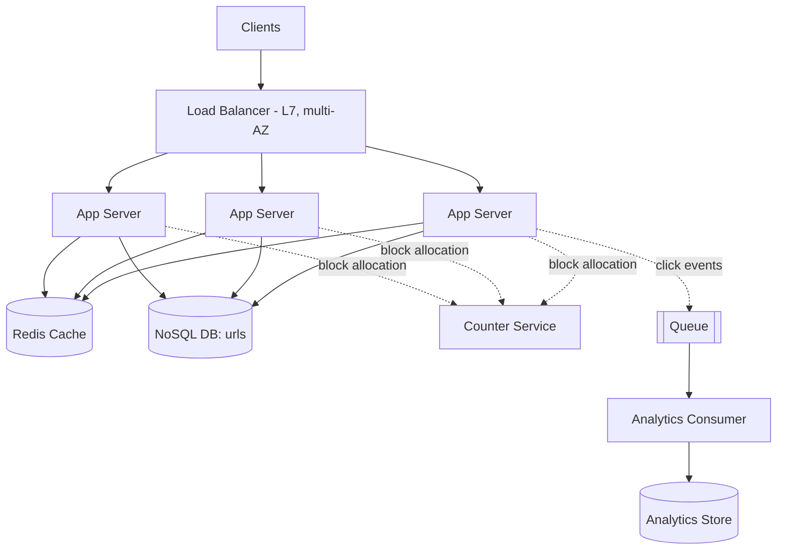
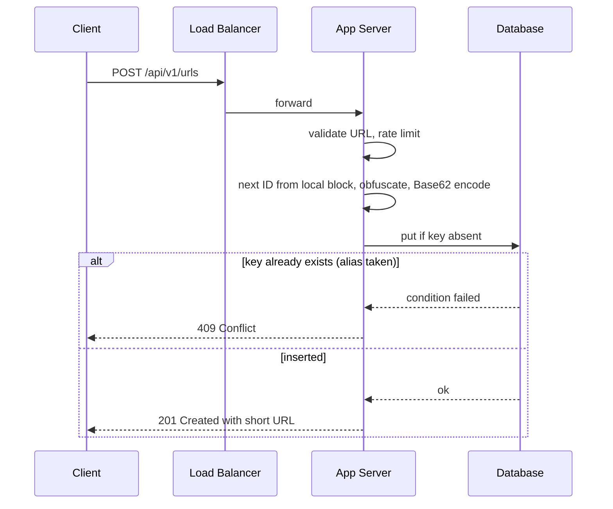
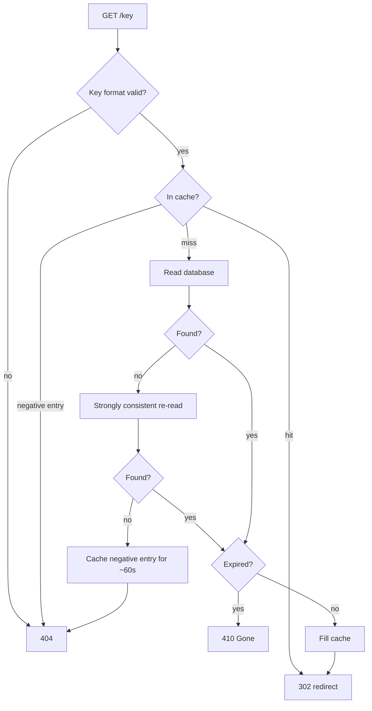
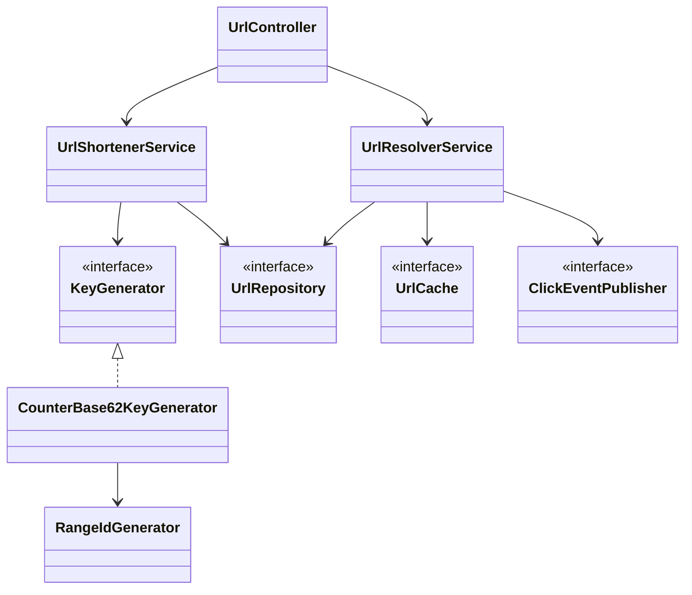

# Designing a URL Shortener (HLD + LLD)

A complete, beginner-friendly walkthrough of how to design a URL shortener like bit.ly or TinyURL.
It follows the order you would use in a system design interview: **requirements → estimation → API → data model → key generation → high-level design → low-level design → scaling and failures.**

Every decision comes with **why it was chosen** and **what it costs (trade-offs)**. Every new term is explained where it first appears, and there is a glossary at the end.

---

## Table of contents

1. [The problem](#1-the-problem)
2. [Requirements](#2-requirements)
3. [Estimation (back-of-the-envelope)](#3-estimation-back-of-the-envelope)
4. [API design](#4-api-design)
5. [Data model and database choice](#5-data-model-and-database-choice)
6. [Core problem: generating the short key](#6-core-problem-generating-the-short-key)
7. [High-level design (HLD)](#7-high-level-design-hld)
8. [Low-level design (LLD)](#8-low-level-design-lld)
9. [Scaling and failure scenarios](#9-scaling-and-failure-scenarios)
10. [Security and abuse](#10-security-and-abuse)
11. [Observability](#11-observability)
12. [Common interview follow-ups](#12-common-interview-follow-ups)
13. [Decision summary](#13-decision-summary)
14. [Glossary](#14-glossary)

---

## 1. The problem

A real product link can look like this:

```
https://www.example.com/products/some-long-name/dp/B0ABC12345/ref=sr_1_3?keywords=laptop&qid=1699999999&sr=8-3&tag=xyz
```

Long links are hard to share (character limits on SMS and social posts), ugly in chat, make QR codes dense and hard to scan, and give the owner no click tracking.

**Solution:** replace the long URL with a short one.

```
https://sho.rt/aZ3kP9x
```

When someone opens the short link, the system looks up the original URL and **redirects** the browser to it.

The system does only two things:

| Operation | Input | Output |
|---|---|---|
| **Shorten** | Long URL | Short URL |
| **Redirect** | Short URL | Browser is sent to the long URL |

Under the hood it is one giant **key-value dictionary**:

```
"aZ3kP9x"  ->  "https://www.example.com/products/..."
"bT7mQ2w"  ->  "https://www.youtube.com/watch?v=..."
```

This single observation drives the database choice, caching, and scaling later.

**Why it is a popular interview question:** it touches hashing/ID generation, caching, database design, and estimation, all in a small problem.

---

## 2. Requirements

Always clarify requirements before designing. "Design a URL shortener" is an incomplete question, and different answers lead to different designs.

### Functional requirements (what the system does)

| # | Requirement | Scope |
|---|---|---|
| 1 | Given a long URL, return a unique short URL | Core |
| 2 | Given a short URL, redirect to the original | Core |
| 3 | Custom alias (`sho.rt/my-brand`) | Optional, in scope |
| 4 | Link expiry (for example 30 days) | Optional, in scope |
| 5 | Click analytics | Optional, handled asynchronously |
| 6 | User accounts and "my links" | Out of scope, design stays extensible |

### Non-functional requirements (how well it works)

| Requirement | Meaning | Why it matters here | Design impact |
|---|---|---|---|
| **Read-heavy** | Reads are far more frequent than writes | A link is created once but clicked thousands of times (about 100:1) | Cache and read replicas |
| **Low latency** | Redirect in about 10-50 ms | Redirect sits in the user's path | Few hops, async analytics |
| **High availability** | System is almost always up (99.99% means about 52 minutes of downtime per year) | A printed or shared link cannot be changed later. If the service is down, every existing link breaks | No single point of failure, replication |
| **Uniqueness** | No two long URLs share a key | A collision sends one user to another user's link | Careful key generation |
| **Unpredictable keys** | Keys cannot be guessed in sequence | Prevents *enumeration*, where an attacker iterates keys to harvest private links | Random or obfuscated keys |
| **Scalability** | Billions of URLs over years | Growth | Stateless servers, partitioned storage |
| **Durability** | A saved link is never lost | Trust | Persistent database is the source of truth, not the cache |

**Functional vs non-functional:** functional is *what* the system does; non-functional is *how well*. Most architecture decisions come from the non-functional list.

---

## 3. Estimation (back-of-the-envelope)

Estimation is not about exact numbers. It tells you which components you need.

**Handy trick:** 1 day is 86,400 seconds, about 10^5 seconds.

**Assumptions** (state them and confirm with the interviewer): 100 million new URLs per month, read:write ratio of 100:1.

| Quantity | Calculation | Result |
|---|---|---|
| Write QPS (queries per second) | 100M / (30 x 86,400 s) | about 40 writes/s |
| Read QPS | 40 x 100 | about 4,000 reads/s average |
| Peak read QPS | average x 2.5 | about 10,000 reads/s |
| Total URLs in 5 years | 100M x 12 x 5 | 6 billion |
| Storage | 6B x ~500 bytes per record | about 3 TB (about 9 TB with 3 replicas) |
| Cache size | 20% of daily reads x 500 B (80/20 rule) | about 35 GB |
| Bandwidth | 4,000 x 500 B | about 2 MB/s (not a bottleneck) |

**Why peak and not average:** a system is designed for its busiest moment.

**The 80/20 rule (Pareto principle):** roughly 20% of links get 80% of the traffic, so caching a small hot set helps a lot.

**What these numbers decide:**

- 10K reads/s is heavy for one database, so a **cache is required**.
- 3 TB fits on one machine's disk, but the access pattern is simple key-value, so we choose a store that **partitions automatically** (Section 5).
- 35 GB of hot data fits in a single Redis node, with replicas for availability.

---

## 4. API design

The API is the contract with clients. Defining it first keeps the internals honest.

### Create a short URL

```http
POST /api/v1/urls
Content-Type: application/json

{
  "longUrl": "https://www.example.com/very/long/path?x=1",
  "customAlias": "my-brand",
  "expiryDays": 30
}
```

```http
201 Created
{
  "shortUrl": "https://sho.rt/aZ3kP9x",
  "shortKey": "aZ3kP9x"
}
```

| Choice | Why |
|---|---|
| `POST` | A new resource is created |
| `/api/v1/` | **Versioning**: future changes do not break old clients |
| `201 Created` | More precise than 200 |
| URL in the body, not the query string | Long URLs contain `?` and `&`, which makes query-string encoding messy |
| `customAlias`, `expiryDays` optional | They are optional requirements |

### Redirect

```http
GET /aZ3kP9x

302 Found
Location: https://www.example.com/very/long/path?x=1
```

This endpoint is **not** under `/api/v1/`, because the short URL itself must stay short.

### 301 vs 302

| | 301 Moved Permanently | 302 Found (temporary) |
|---|---|---|
| Browser caches the redirect | Yes | No |
| Server load | Lower | Higher |
| Click analytics | Not possible (server never sees repeat clicks) | Possible |
| Changing or expiring a link | Hard (browsers remember the old target) | Easy |

**Decision: 302**, because we want expiry and analytics. The extra load is absorbed by the cache. If analytics were out of scope, 301 plus a CDN would cut load drastically.

### Error responses

| Situation | Status |
|---|---|
| Invalid URL | 400 Bad Request |
| Custom alias already taken | 409 Conflict |
| Short key does not exist | 404 Not Found |
| Link has expired | 410 Gone (it existed, now it does not) |
| Too many requests (abuse) | 429 Too Many Requests |

### Idempotency

An operation is **idempotent** if repeating it gives the same result. If a client retries a `POST` after a network failure, it may create a duplicate key. Options: always create a new key (simple, wasted keys are harmless), map the same long URL to the same key (needs an extra lookup), or require an `Idempotency-Key` header (production-grade). Which one depends on requirements.

---

## 5. Data model and database choice

### Access pattern

| Query | Frequency |
|---|---|
| Look up `long_url` by `short_key` | Very high (every redirect) |
| Insert a new mapping | Low (about 40/s) |
| Expire old rows | Background |

About 99% of the work is "given a key, return a value". There are no joins, no multi-row transactions, and no complex queries. This is a pure **key-value access pattern**.

### Choice: NoSQL key-value store (for example DynamoDB or Cassandra)

| Fact | Why a key-value NoSQL store fits |
|---|---|
| Pure key-value lookups | Natural fit |
| No joins or transactions needed | We lose nothing by giving them up |
| Billions of rows, growing | **Partitioning (sharding) and replication are built in**, so we do not build a shard router or manage failover ourselves |
| High availability required | Multi-AZ replication is built in |
| Redirects can tolerate slightly stale data | Eventual consistency is acceptable (an AP choice in CAP terms) |

> **Note:** a relational database (such as MySQL) would also work for a long time, since 3 TB fits on one machine. The deciding factor is that we would have to build and operate sharding and failover ourselves. The decision should come from the access pattern and requirements, not from familiarity.

### Schema

```
Table: urls
  Partition key : short_key   (string)
  Attributes    : long_url, user_id (optional), created_at, expires_at (TTL attribute)
```

**Partition key:** the database hashes `short_key` to decide which partition stores the row. Because keys are random-looking, data spreads evenly and there is no hot partition.

**TTL (time to live):** the database deletes a row automatically after `expires_at`. This removes the need for a cleanup job. The delete is not instant (it can lag by minutes to hours), so the application must **also check expiry on read**.

**Uniqueness via conditional write:** insert only if the key does not exist.

```
PutItem(short_key = "aZ3kP9x", ...)
  condition: attribute_not_exists(short_key)
```

If the key exists, the write fails. This single atomic operation is the final guard against duplicates.

### Trade-offs of NoSQL

| Limitation | Workaround |
|---|---|
| "List all links for a user" | Secondary index on `user_id` (eventually consistent, extra cost) |
| "Same long URL gives same key" | Separate lookup table from `hash(long_url)` to `short_key` |
| Analytics queries | Separate analytics system fed by a queue |
| Strong consistency is slower and costlier | Use it only where needed (see read path) |

---

## 6. Core problem: generating the short key

This is the heart of the design. The key must be **unique, short, fast to generate, and unpredictable.**

### 6.1 Base62 encoding

We want keys made only of URL-safe characters. **Base62** uses 62 symbols:

```
0-9  (10)  +  a-z  (26)  +  A-Z  (26)  =  62 characters
```

**Why not Base64?** Base64 adds `+` and `/`, which have special meaning in URLs (`/` is the path separator), plus `=` padding.

**Encoding** converts a number into a Base62 string, exactly like converting decimal to binary: divide repeatedly by 62, collect the remainders, and read them in reverse.

```
Encode 125000:
125000 / 62 = 2016  remainder  8  -> '8'
  2016 / 62 =   32  remainder 32  -> 'w'
    32 / 62 =    0  remainder 32  -> 'w'
Remainders reversed: "ww8"
```

```java
public final class Base62 {
    private static final String ALPHABET =
        "0123456789abcdefghijklmnopqrstuvwxyzABCDEFGHIJKLMNOPQRSTUVWXYZ";

    public static String encode(long num, int minLength) {
        StringBuilder sb = new StringBuilder();
        while (num > 0) {
            sb.append(ALPHABET.charAt((int) (num % 62)));
            num /= 62;
        }
        while (sb.length() < minLength) sb.append('0');   // pad to fixed length
        return sb.reverse().toString();
    }
}
```

**How long must the key be?** With `n` characters there are 62^n possible keys.

| Length | Combinations |
|---|---|
| 5 | about 916 million |
| 6 | about 56.8 billion |
| 7 | about 3.5 trillion |

We need 6 billion URLs. Six characters would technically fit, but **7 characters** leaves headroom for collision handling and future growth while keeping the URL short.

### 6.2 Approach A: hash and truncate

Hash the long URL (MD5 or SHA-256), take the first ~41 bits, and Base62-encode them.

| Pros | Cons |
|---|---|
| Same long URL always gives the same key | **Collisions**: truncating the hash means two URLs can share a key. With 6B existing keys in a 3.5T space, about 0.17% of inserts collide |
| No counter or coordination | Needs a conditional write and a retry loop |
| Looks random | Retries add a little latency |

Collision handling: if the key exists and points to a different URL, append a **salt** (extra string) to the input and hash again.

### 6.3 Approach B: counter + Base62

Keep a counter (1, 2, 3, ...) and Base62-encode the number.

| Pros | Cons |
|---|---|
| **Zero collisions**: every number is unique | **Predictable**: `...ww8`, `...ww9`, `...wwA` can be enumerated |
| Very fast | A single counter is a **single point of failure and a bottleneck** |

**Fix 1: range (block) allocation.** A counter service hands each app server a block of, say, 1 million IDs. The server then counts locally in memory and asks for a new block only when the current one is used up.

```
Counter service value: 3,000,000
Server 1 asks -> receives 3,000,000 .. 3,999,999
Server 2 asks -> receives 4,000,000 .. 4,999,999
```

Why it works: the counter service is hit rarely (once per million IDs per server), so load is tiny. If it is briefly down, servers keep using their remaining block. A crash wastes only the unused part of a block, which is harmless in a 3.5-trillion space. The counter itself uses an **atomic increment** (read, add, and write as one indivisible step) so two servers never receive the same block.

**Fix 2: obfuscation.** Shuffle the sequence so keys look random but stay unique:

```
shuffled = (counter x K) mod 62^7
```

`K` must be **coprime** with 62^7 (they share no factor except 1; since 62 = 2 x 31, K must not be divisible by 2 or 31). Then the mapping is a **bijection**: every counter value maps to a distinct output, so uniqueness is preserved while the sequence is scrambled.

> This is **obfuscation, not encryption.** A determined attacker with many samples could recover `K`. For stronger protection use a Feistel network or a small-block cipher.

### 6.4 Approach C: Key Generation Service (KGS)

A separate service pre-generates random unique keys and stores them in an "unused" pool. App servers fetch batches of keys and mark them used.

| Pros | Cons |
|---|---|
| No collisions, keys are truly random | Extra component and storage to run |
| Very fast write path | The KGS itself must be replicated |
| | Concurrency care: two servers must never receive the same key |

### 6.5 Why not Snowflake IDs?

A Snowflake ID is a 64-bit time-ordered unique ID generated without central coordination. Base62-encoded, 64 bits is about **11 characters**, which defeats the purpose of a *short* URL. It is also time-ordered and therefore somewhat predictable. It is a great fit for internal IDs, not for short keys.

### 6.6 Comparison and decision

| | A: Hash | B: Counter | C: KGS |
|---|---|---|---|
| Collision | Possible (must handle) | None | None |
| Predictable | No | Yes (needs obfuscation) | No |
| Same URL gives same key | Yes | No | No |
| Extra component | No | Counter service (small) | KGS + pool |
| Write latency | Hash + conditional write | Local counter (fastest) | Memory lookup |
| Complexity | Low | Medium | High |

**Decision: counter + Base62 with range allocation and obfuscation.**

1. Zero collisions, so no retry logic on the common path.
2. Fastest write path (a local counter).
3. Counter service load is negligible and it can fail briefly without impact.
4. Predictability is solved by obfuscation without running a separate key pool.

Costs accepted: wasted IDs on crashes (irrelevant at this scale), and the same long URL may get different keys.

**When to choose differently:** choose hashing if "same URL gives same key" is required; choose KGS if keys must be truly random for security.

### 6.7 Custom aliases

Users may request `sho.rt/my-brand`. Handle it with:

- The same **conditional write**; if it fails, return **409 Conflict**.
- A **reserved-word list** (`api`, `admin`, `login`, `health`, ...) so aliases cannot shadow real routes.
- A format rule (for example 4-30 characters of letters, digits, `-`, `_`).
- Rate limiting on alias creation to prevent squatting.

**Can a Bloom filter help?** A *Bloom filter* is a compact structure that answers "definitely not present" or "probably present" (false positives are possible, false negatives are not). For aliases it can skip a database read when it says "not present". But two users can request the same alias at the same instant, so the **conditional write remains the final authority**. Because alias creation is rare, a Bloom filter is optional here. It is more valuable on the redirect path to block lookups of keys that do not exist.

---

## 7. High-level design (HLD)

Build the design incrementally and justify each addition:

| Step | Component added | Problem it solves |
|---|---|---|
| 1 | Client, app server, database | Basic functionality |
| 2 | Load balancer and multiple app servers | Single point of failure, capacity |
| 3 | Cache | 10K reads/s should not hit the database |
| 4 | Counter service | Many servers need globally unique IDs |
| 5 | Async queue for analytics | Keep redirect fast |
| 6 | Replication and multi-AZ | Availability |

### Architecture



### Component decisions

**Load balancer (Layer 7).** Spreads traffic across servers so no single server is a point of failure. L7 (application layer) understands HTTP paths, so create and redirect can be handled differently, and it terminates SSL. Round Robin is enough because requests are short and similar. Use a managed multi-AZ load balancer so it is not itself a single point of failure.

**App servers (stateless).** A server keeps no per-user state, so any server can handle any request and capacity grows by simply adding servers. The only local state is the unused part of an ID block, and losing it is harmless.

**Cache (Redis, cache-aside).** Holds `short_key -> long_url` in memory (about 0.5 ms vs 5-20 ms for the database). With the 80/20 rule, 95%+ of reads are served from cache.

- *Cache-aside:* the app checks the cache, and on a miss reads the database and fills the cache. If Redis is down, the app still works from the database (graceful degradation).
- TTL = `min(link's remaining lifetime, 24h)` plus random jitter, so an expired link is never served from cache and entries do not all expire together.
- Eviction policy: `allkeys-lru` (drop least recently used) to keep hot links.
- The cache is not filled on create, because a new link's first read may be far away, and caching every new link pollutes the cache.
- Trade-off: after a delete or expiry the cache can be briefly stale, mitigated by evicting on delete and by the TTL.

**Database (NoSQL).** The source of truth, as described in Section 5.

**Counter service.** Hands out ID blocks with an atomic counter. Use a durable store (a database atomic counter). A plain in-memory counter could move backwards after a crash and hand out duplicates. **Defense in depth:** even if a bug produced a duplicate ID, the database conditional write would reject it and the request would retry.

**Async queue for analytics.** Each click publishes an event to a queue; a consumer writes to an analytics store. Redirect never waits for analytics, and if the queue is down, redirects continue (analytics may lose a few events, which is acceptable).

**CDN.** Because we use 302 and want every click to reach us for analytics and expiry, we do not cache redirects at the CDN. A CDN would help if we used 301 and gave up analytics.

### Write path (shorten)



1. **Validate** the URL (format, scheme, blocklist). Storing malicious links harms users and your domain's reputation.
2. **Rate limit** to stop mass link creation and alias squatting.
3. **Generate the key** from the local block, with no network call on the common path.
4. **Conditional write**, the final uniqueness guard.
5. Return `201`.

### Read path (redirect), about 99% of traffic



- **Format check first:** requests like `/favicon.ico` or random bot paths never reach the database.
- **Cache first:** most requests end here in about a millisecond.
- **Strongly consistent re-read on a miss:** a freshly created link may not have reached a replica yet (replication lag). One slower but fully up-to-date read avoids a false 404.
- **Negative caching:** remember "this key does not exist" for a short time so attackers sending random keys do not hammer the database (this defends against *cache penetration*).
- **Expiry check on read:** TTL deletion is delayed, so rows can outlive their expiry.
- **Click event** is published asynchronously after the response is ready.

### Single points of failure checklist

| Component | SPOF? | Fix |
|---|---|---|
| Load balancer | Yes | Managed multi-AZ |
| App servers | No | Many stateless instances |
| Redis | Yes | Replicas plus automatic failover |
| Database | Yes | Multi-AZ replication |
| Counter service | Yes | Replicated, plus local blocks as a buffer |
| Queue | Yes | Managed and replicated; redirects work without it |
| Single region | Yes | Multi-region with DNS failover |

### Multi-region (bonus)

Route users to the nearest region with latency/geo DNS routing, replicate the database across regions, run a cache per region, and give each region a **different ID range** so regions never need to coordinate. Trade-off: cross-region replication is eventual, so a new link may take a few seconds to appear elsewhere, which is acceptable for redirects.

---

## 8. Low-level design (LLD)

HLD draws the boxes; LLD designs the code inside them. Goals: clear responsibilities, easy to swap parts, safe under concurrency, easy to test.

### Responsibilities (Single Responsibility Principle)

| Job | Class / interface | Why separate |
|---|---|---|
| Generate keys | `KeyGenerator` (interface) | Swap hash, counter, or KGS without touching the service |
| Hand out ID blocks | `RangeIdGenerator`, `IdBlockProvider` | Isolates concurrency logic |
| Validate URLs and aliases | `UrlValidator`, `AliasPolicy` | Rules change often |
| Persist data | `UrlRepository` (interface) | Change databases without touching services |
| Cache | `UrlCache` (interface) | Change cache technology freely |
| Publish click events | `ClickEventPublisher` (interface) | Kafka or SQS is invisible to redirect logic |
| Create flow | `UrlShortenerService` | Write path |
| Redirect flow | `UrlResolverService` | Read path |
| HTTP handling | `UrlController` | No business logic |

Write and read are separate services because their load differs by about 100x and they can later be deployed and scaled independently.



Services depend on **interfaces**, not implementations (Dependency Inversion), which makes them easy to unit test with mocks.

### Entity

```java
public record UrlMapping(String shortKey, String longUrl, Long userId,
                         Instant createdAt, Instant expiresAt) {

    public boolean isExpired(Instant now) {
        return expiresAt != null && now.isAfter(expiresAt);
    }
}
```

A `record` is immutable, so it is safe to share across threads and store in caches. `isExpired` takes `now` as a parameter so tests can control time.

### Exceptions mapped to HTTP codes

```java
public class InvalidUrlException  extends RuntimeException { public InvalidUrlException(String m)  { super(m); } } // 400
public class AliasTakenException  extends RuntimeException { public AliasTakenException(String a)  { super(a); } } // 409
public class UrlNotFoundException extends RuntimeException { public UrlNotFoundException(String k) { super(k); } } // 404
public class UrlExpiredException  extends RuntimeException { public UrlExpiredException(String k)  { super(k); } } // 410
```

```java
@RestControllerAdvice
public class ApiExceptionHandler {
    @ExceptionHandler(InvalidUrlException.class)
    ResponseEntity<String> bad(InvalidUrlException e)       { return ResponseEntity.badRequest().body(e.getMessage()); }
    @ExceptionHandler(AliasTakenException.class)
    ResponseEntity<String> conflict(AliasTakenException e)  { return ResponseEntity.status(409).body("alias taken"); }
    @ExceptionHandler(UrlNotFoundException.class)
    ResponseEntity<Void> notFound()                         { return ResponseEntity.notFound().build(); }
    @ExceptionHandler(UrlExpiredException.class)
    ResponseEntity<Void> gone()                             { return ResponseEntity.status(410).build(); }
}
```

Business code knows nothing about HTTP status codes; that mapping lives in one place.

### Key generation (Strategy pattern)

```java
public interface KeyGenerator {
    String nextKey();
}
```

```java
public class CounterBase62KeyGenerator implements KeyGenerator {
    private static final int KEY_LENGTH = 7;
    private static final BigInteger SPACE = BigInteger.valueOf(62).pow(KEY_LENGTH);  // 62^7
    private static final BigInteger K = BigInteger.valueOf(1_000_000_007L);          // coprime with 62^7

    private final RangeIdGenerator idGenerator;

    public CounterBase62KeyGenerator(RangeIdGenerator idGenerator) {
        this.idGenerator = idGenerator;
    }

    @Override
    public String nextKey() {
        BigInteger id = BigInteger.valueOf(idGenerator.nextId());
        long shuffled = id.multiply(K).mod(SPACE).longValue();
        return Base62.encode(shuffled, KEY_LENGTH);
    }
}
```

- `KeyGenerator` is an interface (Strategy pattern), so a different algorithm can be added without changing the service (Open/Closed Principle).
- `BigInteger` is used because `counter x K` can exceed the range of `long` (about 10^10 x 10^9 = 10^19 > 9.2 x 10^18). A silent overflow would create duplicate keys.
- The bijection only holds while the counter stays below 62^7, so alert on key-space usage (Section 11).

### Range ID generator (concurrency)

```java
public interface IdBlockProvider {
    long allocateBlock(long size);     // atomic; returns the start of the block
}
```

```java
public class RangeIdGenerator {
    private static final long BLOCK_SIZE = 1_000_000L;

    private final IdBlockProvider provider;
    private long current;
    private long max;                  // exclusive

    public RangeIdGenerator(IdBlockProvider provider) { this.provider = provider; }

    public synchronized long nextId() {
        if (current >= max) {
            long start = provider.allocateBlock(BLOCK_SIZE);
            current = start;
            max = start + BLOCK_SIZE;
        }
        return current++;
    }
}
```

- `synchronized` is required because `current++` is not thread-safe. At about 40 writes/s the lock is irrelevant; at high load use `AtomicLong`.
- Weakness: fetching a new block happens inside the lock, so other threads wait briefly (once per million IDs). Improvement: **prefetch** the next block in the background at roughly 80% usage.
- A restart is safe: it requests a new block, which always lies ahead of anything previously issued.

### Validation (security-relevant)

```java
public class UrlValidator {
    private static final int MAX_LENGTH = 2048;
    private final Set<String> blockedHosts;

    public UrlValidator(Set<String> blockedHosts) { this.blockedHosts = blockedHosts; }

    public void validate(String longUrl) {
        if (longUrl == null || longUrl.length() > MAX_LENGTH)
            throw new InvalidUrlException("url missing or too long");
        URI uri;
        try { uri = new URI(longUrl); }
        catch (URISyntaxException e) { throw new InvalidUrlException("malformed url"); }

        String scheme = uri.getScheme();
        if (!"http".equalsIgnoreCase(scheme) && !"https".equalsIgnoreCase(scheme))
            throw new InvalidUrlException("only http/https allowed");   // blocks javascript:, file:

        String host = uri.getHost();
        if (host == null || blockedHosts.contains(host.toLowerCase()))
            throw new InvalidUrlException("host not allowed");
    }
}
```

Allowing only `http` and `https` prevents `javascript:` (script injection) and `file:` (local file exposure) targets.

```java
public class AliasPolicy {
    private static final Pattern FORMAT = Pattern.compile("^[a-zA-Z0-9_-]{4,30}$");
    private static final Set<String> RESERVED =
        Set.of("api", "admin", "login", "health", "static", "favicon.ico", "robots.txt");

    public void check(String alias) {
        if (!FORMAT.matcher(alias).matches())
            throw new InvalidUrlException("alias must be 4-30 chars: letters, digits, - _");
        if (RESERVED.contains(alias.toLowerCase()))
            throw new InvalidUrlException("alias reserved");
    }
}
```

### Repository

```java
public interface UrlRepository {

    /** true = inserted; false = key already existed (conditional write failed). */
    boolean saveIfAbsent(UrlMapping mapping);

    Optional<UrlMapping> findByKey(String shortKey, boolean strongRead);
}
```

**Why `saveIfAbsent` and not "check `exists()` then `save()`":** two steps leave a gap in which another request can insert the same key (a *check-then-act race*). A conditional write does both atomically inside the database.

```java
public class DynamoUrlRepository implements UrlRepository {
    private final DynamoDbClient client;
    private final String table = "urls";

    @Override
    public boolean saveIfAbsent(UrlMapping m) {
        Map<String, AttributeValue> item = new HashMap<>();
        item.put("short_key",  AttributeValue.fromS(m.shortKey()));
        item.put("long_url",   AttributeValue.fromS(m.longUrl()));
        item.put("created_at", AttributeValue.fromN(String.valueOf(m.createdAt().getEpochSecond())));
        if (m.userId() != null)    item.put("user_id",    AttributeValue.fromN(m.userId().toString()));
        if (m.expiresAt() != null) item.put("expires_at", AttributeValue.fromN(String.valueOf(m.expiresAt().getEpochSecond())));

        try {
            client.putItem(PutItemRequest.builder()
                .tableName(table)
                .item(item)
                .conditionExpression("attribute_not_exists(short_key)")
                .build());
            return true;
        } catch (ConditionalCheckFailedException e) {
            return false;
        }
    }

    @Override
    public Optional<UrlMapping> findByKey(String key, boolean strongRead) {
        GetItemResponse r = client.getItem(GetItemRequest.builder()
            .tableName(table)
            .key(Map.of("short_key", AttributeValue.fromS(key)))
            .consistentRead(strongRead)
            .build());
        if (!r.hasItem() || r.item().isEmpty()) return Optional.empty();
        return Optional.of(toMapping(r.item()));   // maps attributes back to the record
    }
}
```

`expires_at` is stored as **epoch seconds (a number)** because the database's native TTL feature requires that format.

### Cache abstraction with three states

```java
public interface UrlCache {
    CacheResult get(String key);
    void put(String key, String longUrl, Duration ttl);
    void putNegative(String key, Duration ttl);
    void evict(String key);
}

public record CacheResult(Status status, String longUrl) {
    public enum Status { HIT, NEGATIVE, MISS }
    public static CacheResult hit(String url) { return new CacheResult(Status.HIT, url); }
    public static CacheResult negative()      { return new CacheResult(Status.NEGATIVE, null); }
    public static CacheResult miss()          { return new CacheResult(Status.MISS, null); }
}
```

Returning `null` cannot distinguish "not in cache" from "the cache knows this key does not exist". Three explicit states make negative caching possible.

### Click events

```java
public interface ClickEventPublisher {
    void publish(String shortKey, Instant at);   // fire-and-forget
}
```

Implementations must catch their own errors so a queue failure never fails a redirect.

### Shorten service (write path)

```java
public class UrlShortenerService {
    private static final int MAX_ATTEMPTS = 3;

    private final UrlValidator validator;
    private final AliasPolicy aliasPolicy;
    private final KeyGenerator keyGenerator;
    private final UrlRepository repository;
    private final Clock clock;

    // constructor injection of all dependencies

    public String shorten(String longUrl, String customAlias, Integer expiryDays, Long userId) {
        validator.validate(longUrl);
        Instant now = clock.instant();
        Instant expiresAt = expiryDays == null ? null : now.plus(Duration.ofDays(expiryDays));

        if (customAlias != null) {
            aliasPolicy.check(customAlias);
            boolean saved = repository.saveIfAbsent(
                new UrlMapping(customAlias, longUrl, userId, now, expiresAt));
            if (!saved) throw new AliasTakenException(customAlias);
            return customAlias;
        }

        for (int attempt = 0; attempt < MAX_ATTEMPTS; attempt++) {
            String key = keyGenerator.nextKey();
            if (repository.saveIfAbsent(new UrlMapping(key, longUrl, userId, now, expiresAt)))
                return key;                     // a clash here is extremely rare; retry silently
        }
        throw new IllegalStateException("could not allocate key");
    }
}
```

- `Clock` is injected instead of calling `Instant.now()` directly, so tests can fix the time.
- A taken **custom alias** returns `409` (the user must know). A clash on a **generated key** is retried silently (it is not the user's fault).

### Resolve service (read path)

```java
public class UrlResolverService {
    private static final Duration MAX_CACHE_TTL = Duration.ofHours(24);
    private static final Duration NEGATIVE_TTL  = Duration.ofSeconds(60);
    private static final Pattern KEY_FORMAT = Pattern.compile("^[a-zA-Z0-9_-]{4,30}$");

    private final UrlCache cache;
    private final UrlRepository repository;
    private final ClickEventPublisher clicks;
    private final Clock clock;

    public String resolve(String key) {
        if (!KEY_FORMAT.matcher(key).matches())
            throw new UrlNotFoundException(key);              // never touch the database

        CacheResult c = cache.get(key);
        switch (c.status()) {
            case HIT:      clicks.publish(key, clock.instant()); return c.longUrl();
            case NEGATIVE: throw new UrlNotFoundException(key);
            default:       break;                              // MISS
        }

        UrlMapping m = repository.findByKey(key, false)
            .or(() -> repository.findByKey(key, true))        // retry with a strong read
            .orElse(null);

        if (m == null) {
            cache.putNegative(key, NEGATIVE_TTL);
            throw new UrlNotFoundException(key);
        }

        Instant now = clock.instant();
        if (m.isExpired(now)) throw new UrlExpiredException(key);

        cache.put(key, m.longUrl(), ttlFor(m, now));
        clicks.publish(key, now);
        return m.longUrl();
    }

    private Duration ttlFor(UrlMapping m, Instant now) {
        long jitter = ThreadLocalRandom.current().nextLong(0, 300);     // 0-5 minutes
        Duration ttl = MAX_CACHE_TTL.plusSeconds(jitter);
        if (m.expiresAt() != null) {
            Duration remaining = Duration.between(now, m.expiresAt());
            if (remaining.compareTo(ttl) < 0) ttl = remaining;          // never outlive the link
        }
        return ttl;
    }
}
```

Not shown: protection against a *cache stampede* (many requests hitting the database when a hot key expires). See Section 9.

### Controller

```java
@RestController
public class UrlController {
    private final UrlShortenerService shortener;
    private final UrlResolverService resolver;
    private final String baseUrl;

    @PostMapping("/api/v1/urls")
    public ResponseEntity<Map<String, String>> create(@RequestBody CreateRequest req) {
        String key = shortener.shorten(req.longUrl(), req.customAlias(), req.expiryDays(), null);
        return ResponseEntity.status(HttpStatus.CREATED)
                .body(Map.of("shortUrl", baseUrl + "/" + key, "shortKey", key));
    }

    @GetMapping("/{key}")
    public ResponseEntity<Void> redirect(@PathVariable String key) {
        String target = resolver.resolve(key);
        return ResponseEntity.status(HttpStatus.FOUND)
                .header(HttpHeaders.LOCATION, target)
                .header(HttpHeaders.CACHE_CONTROL, "no-store")   // some clients cache 302s; we need every click
                .build();
    }
}

public record CreateRequest(String longUrl, String customAlias, Integer expiryDays) {}
```

### Design patterns and principles used

| Pattern / principle | Where | Benefit |
|---|---|---|
| Strategy | `KeyGenerator` | Swap the key algorithm |
| Repository | `UrlRepository` | Swap the database |
| Dependency Inversion | All interfaces | Testable and loosely coupled |
| Single Responsibility | Validator, policy, services separated | One class, one job |
| Open/Closed | New `KeyGenerator` needs no service change | Extend without modifying |
| Immutable value object | `UrlMapping` record | Thread-safe and cache-safe |

### What to test

| Test | Method |
|---|---|
| Base62 encode | Known values (`125000` gives `ww8`), padding, zero |
| Obfuscation is a bijection | Generate 1 million keys, assert all are unique |
| `RangeIdGenerator` under concurrency | 100 threads x 10K calls, assert all IDs unique |
| Alias taken | Mock repository returns `false`, expect `AliasTakenException` |
| Expiry | Fixed `Clock`, test just before and after `expiresAt` |
| Cache TTL | Near-expiry link gets a shorter TTL; jitter stays in range |
| Negative cache | Second request for a missing key does not reach the database |

---

## 9. Scaling and failure scenarios

### Traffic growth

| Growth | What breaks first | Fix | Trade-off |
|---|---|---|---|
| 10x reads | App CPU, one Redis node | Autoscale app servers, Redis Cluster (data split across hash slots) | Cluster complexity |
| 100x reads | Hot keys, network | Local in-process cache (L1) on every app server | Brief staleness |
| 100x writes | Counter service block requests | Larger blocks (1M to 10M) | More waste on crash, harmless |
| 10x storage | Nothing to do | Managed NoSQL partitions automatically | Cost |

Reads break first because of the 100:1 ratio, so most effort goes into cache layers.

### Viral link (hot key)

One link receives a million clicks in a minute, all on one key, so one cache node takes all the load.

- **Fix:** a small **L1 cache** inside each app server (5-10 s TTL). The load is spread over all app servers' memory instead of one Redis node.
- **Stampede protection:** when an entry expires, thousands of threads may reload it at once. Use **single-flight** loading so only one thread reloads while the rest wait.

```java
LoadingCache<String, String> l1 = Caffeine.newBuilder()
    .maximumSize(100_000)
    .expireAfterWrite(Duration.ofSeconds(10))
    .build(key -> loadFromRedisThenDb(key));   // one loader per key, others wait
```

- Trade-off: after a takedown or delete, L1 can serve the link for up to its TTL. For urgent takedowns, keep the TTL short or invalidate via pub/sub.

### Cache problems and their fixes

| Problem | What happens | Fix |
|---|---|---|
| **Stampede** (thundering herd) | One hot key expires, thousands of requests hit the database | Single-flight or mutex, TTL jitter |
| **Penetration** | Requests for keys that do not exist always reach the database | Format check, negative cache, Bloom filter |
| **Avalanche** | Many keys expire together, or Redis goes down | TTL jitter, Redis replicas and failover, L1 cache, load shedding |
| **Hot key** | One key overloads one node | L1 cache, key replication |
| **Stale data** | Cache and database diverge | TTL as backstop, evict on write |

### Component failures

| Component fails | Effect | Behaviour |
|---|---|---|
| App server | Health check fails, removed from rotation | Others absorb traffic |
| Redis | Reads go to the database | Replica failover; L1 and load shedding protect the database; redirects slower but working |
| One availability zone | Database and load balancer are multi-AZ | Transparent |
| Counter service | No new blocks | Servers use their remaining block; create fails with 503 only after it is exhausted; **redirects are unaffected** |
| Queue | Click events delayed or lost | Redirects continue; analytics approximate |
| Whole region | Region outage | Multi-region and DNS failover |

The key insight: the **redirect path has the fewest dependencies** (load balancer, app, cache/database), while the create path has more (counter service). So if creation breaks, existing links keep working, and those links are the real product.

### Expiry and deletion edge cases

- Native TTL deletion is delayed, so reads must check `expires_at`.
- If an expired alias is immediately reusable, an old printed link could point somewhere new. Use a **cooling period** (for example 90 days) before reuse.
- On delete: remove from the database, evict from Redis, and invalidate L1.

---

## 10. Security and abuse

| Threat | How | Mitigation |
|---|---|---|
| Phishing and malware links | Attacker hides a bad link behind your trusted domain | Blocklist or Safe Browsing check on create, report and takedown flow, warning page |
| Enumeration | Iterating keys to harvest private links | Obfuscated keys, rate limit on 404s |
| Alias squatting | Grabbing all good aliases | Rate limits, require login |
| Dangerous schemes | `javascript:`, `file:` targets | Allow only `http` and `https` |
| Storage exhaustion | Scripts creating millions of links | Per-IP and per-user rate limiting, CAPTCHA |
| DDoS on redirects | Fake traffic | WAF, CDN-level protection, rate limiting |
| Redirect loops | Short link pointing to another short link | Reject your own domain as a target |
| SSRF (if you ever fetch link previews) | Tricking the server into calling internal addresses such as `localhost` or cloud metadata endpoints | Block private IP ranges and internal hosts |

---

## 11. Observability

| Metric | Why | Alert when |
|---|---|---|
| Redirect latency p50 / p99 | Latency requirement | p99 above 100 ms |
| **Cache hit ratio** | Falling ratio means more database load | Below 90% |
| 5xx error rate | Availability | Above 0.1% |
| 404 rate | A spike suggests scanning or an attack | Sudden jump |
| Counter block remaining | Warn before blocks run out | Below 10% |
| **Key space used** | Obfuscation is only unique below 62^7 | Above 50% |
| Database throttling | Capacity | Any |
| Queue lag | Analytics delay | Growing |

---

## 12. Common interview follow-ups

| Question | Short answer |
|---|---|
| Same long URL submitted twice? | Depends on requirements. If the same key is needed, keep a `hash(longUrl) -> key` lookup (extra write and index); otherwise create a new key each time |
| 301 or 302? | 302 for analytics and expiry; 301 only if reducing load matters more |
| What if keys run out? | 62^7 is 3.5 trillion and 6B is about 0.17% of it. If ever needed, move to 8 characters; old keys keep working |
| Why not UUIDs? | 128 bits is about 22 Base62 characters, not short. Truncating brings collisions back |
| Real-time analytics? | Stream processing on the click events; approximate unique visitors with HyperLogLog |
| List a user's links? | Secondary index on `user_id`, with pagination |
| Multi-region writes? | Separate ID ranges per region, local conditional writes, eventual replication |
| Counter bug issues a duplicate ID? | The conditional write rejects it; retry with a new key. Two layers of protection |

### Two-minute summary

> "It is a read-heavy system, about 100:1, with roughly 40 writes and 4K reads per second, 6 billion URLs, and about 3 TB. Keys are 7-character Base62, generated from a counter with range allocation and obfuscation, so there are no collisions and keys are not predictable. Storage is a NoSQL key-value store because the access pattern is pure lookup and partitioning is built in. Redirect path: load balancer, stateless app server, Redis cache-aside, and the database on a miss. I use 302 so analytics and expiry work, with click events sent asynchronously. Uniqueness has two layers: the counter and a conditional write. I removed single points of failure with replication, and I handle hot keys with a local cache and abuse with validation, rate limiting, and blocklists."

---

## 13. Decision summary

| Area | Decision | Reason |
|---|---|---|
| Key encoding | Base62, 7 characters, padded | URL-safe, 3.5T combinations |
| Key generation | Counter + range allocation + obfuscation | No collisions, fast, few SPOF concerns |
| Uniqueness | Counter plus database conditional write | Defense in depth |
| Database | NoSQL key-value, `short_key` partition key, native TTL | Matches access pattern, built-in scale |
| Cache | Redis, cache-aside, TTL capped by expiry plus jitter | Offloads 95%+ of reads |
| Redirect | 302, `Cache-Control: no-store` | Analytics and expiry |
| Analytics | Async queue | Redirect stays fast |
| Not-found handling | Format check and negative cache | Defends against penetration |
| Viral links | L1 in-process cache with single-flight | Avoids hot-key overload |
| Code structure | Interfaces plus Strategy and Repository patterns | Swappable, testable |

---

## 14. Glossary

| Term | Meaning |
|---|---|
| **HLD / LLD** | High-level design (components and connections) / low-level design (classes and code structure) |
| **QPS** | Queries per second |
| **Peak QPS** | Busiest-period QPS, typically 2-3x the average |
| **Read:write ratio** | How many reads occur per write |
| **Latency** | Time from request to response |
| **Availability** | Fraction of time the system works (99.99% is about 52 minutes of downtime per year) |
| **Durability** | Saved data survives crashes |
| **SPOF** | Single point of failure: one component whose failure takes down everything |
| **Stateless server** | Keeps no per-user state in memory, so any server can serve any request |
| **Base62 / Base64** | Number systems using 62 / 64 symbols; Base62 is URL-safe |
| **Hash function** | Maps any input to a fixed-size number; same input gives same output |
| **Collision** | Two different inputs producing the same key |
| **Salt** | Extra text added to an input so its hash changes |
| **Atomic operation** | Read-modify-write as one indivisible step |
| **Conditional write** | Insert only if a condition holds (for example, key does not exist) |
| **Coprime** | Two numbers sharing no factor other than 1 |
| **Bijection** | One-to-one mapping: distinct inputs always give distinct outputs |
| **Obfuscation** | Making a pattern hard to see; not the same as encryption |
| **Enumeration** | Iterating through keys to discover all data |
| **Cache-aside** | App checks the cache first and fills it from the database on a miss |
| **TTL** | Time to live: automatic expiry time of an entry |
| **Negative caching** | Caching the fact that a key does not exist |
| **Cache stampede** | Many requests hit the database at once when a hot key expires |
| **Cache penetration** | Requests for nonexistent keys bypass the cache every time |
| **Cache avalanche** | Many keys expire together, or the whole cache fails |
| **Hot key** | One key receiving disproportionate traffic |
| **Single-flight** | Only one loader runs per key; other callers wait for its result |
| **L1 / L2 cache** | In-process memory cache / shared cache such as Redis |
| **Bloom filter** | Compact set structure: "definitely not present" or "probably present" |
| **Eventual consistency** | Replicas converge after a short delay |
| **Strongly consistent read** | A read guaranteed to reflect the latest write (slower) |
| **Replication lag** | Delay before a replica receives a write |
| **Idempotent** | Repeating the operation gives the same result |
| **Graceful degradation** | When a component fails, the system keeps working with reduced quality |
| **Load shedding** | Deliberately rejecting some requests to avoid total overload |
| **Defense in depth** | Layering several independent safeguards |
| **Strategy pattern** | Hiding interchangeable algorithms behind an interface |
| **Repository pattern** | Hiding data storage behind an interface |
| **SSRF** | Tricking a server into making requests to internal addresses |
| **CDN** | Network of edge servers that cache content close to users |